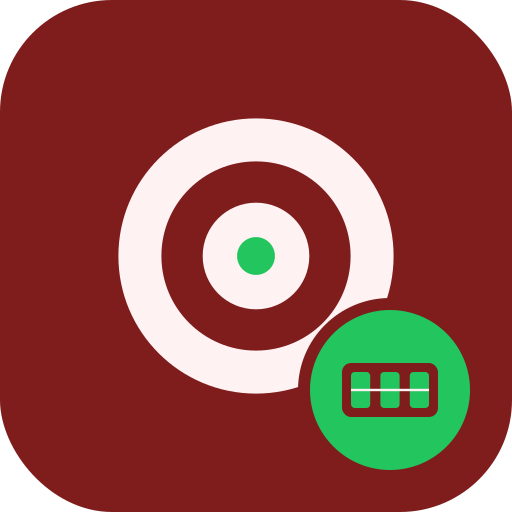

# Dartboard Automatic Calculator

  

A Java desktop program that scores darts automatically from photos of a
dartboard.

## What it does

- `CalibratorUI` lets you calibrate the board geometry on an image by
  dragging points.
- `BoardMapper` maps image positions to dartboard regions.
- `DartboardAnalyzer` compares images to find where darts landed,
  using edge and blob detection.
- `ScoreCalculator` works out the score.

Sample photos and the intermediate images (calibration, difference and
region bitmaps) are in the root of the repository.

## Tech

- Java with AWT and Swing
- Image filters from the JH Labs library

## Building

Import the Eclipse project and run the classes in the
`dartboardextreme` package.

## License

Licensed under the Apache License 2.0. See [LICENSE](LICENSE).
